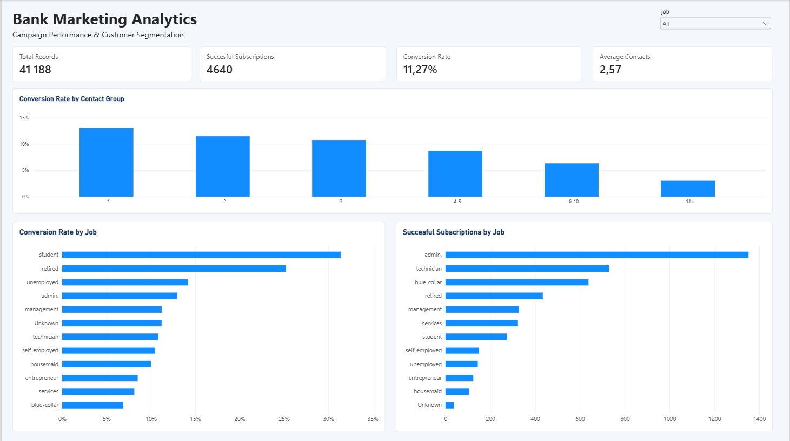
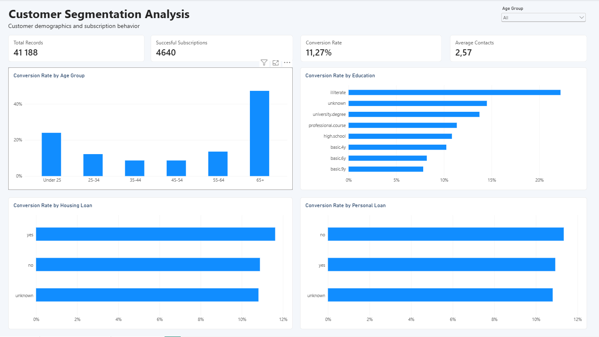
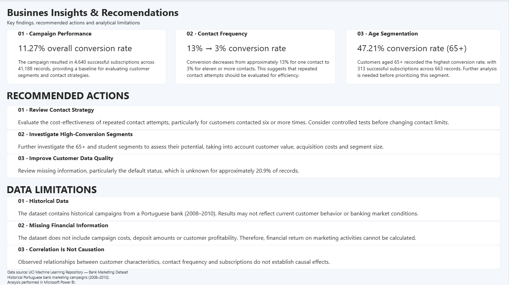

# Bank Marketing Analytics | Power BI

## Project Overview

This project analyzes historical marketing campaign data from a Portuguese banking institution to evaluate campaign effectiveness, customer segmentation, and subscription patterns.

The report was developed in Microsoft Power BI and consists of three interactive pages.

## Business Objectives

- Evaluate overall campaign conversion rates.
- Analyze the relationship between contact frequency and conversion.
- Identify customer segments with higher subscription rates.
- Provide data-driven business recommendations.

## Dataset

**Source:** [UCI Machine Learning Repository — Bank Marketing](https://archive.ics.uci.edu/dataset/222/bank+marketing)

- Records: 41,188
- Period: 2008–2010
- Target variable: Term deposit subscription (`yes` / `no`)

## Tools & Technologies

- Power BI Desktop
- Power Query (M)
- DAX
- Data Cleaning & Transformation
- Data Visualization
- Business Intelligence

## Dashboard Pages

### 1. Campaign Overview
Campaign KPIs, conversion rates by contact frequency, and performance comparisons across occupational groups.

### 2. Customer Segmentation
Conversion analysis by age, education, housing loan status, and personal loan status.

### 3. Business Insights & Recommendations
Key findings, recommended actions, and analytical limitations.

## Key Findings

- Overall conversion rate: **11.27%**
- Successful subscriptions: **4,640**
- Average campaign contacts per record: **2.57**
- Conversion rate for customers aged 65+: **47.21%**
- Observed conversion decreased from approximately 13% for one contact to 3% for eleven or more contacts.
- Personal loan ownership showed relatively small differences in conversion rates.

## Business Recommendations

1. Evaluate the efficiency and costs of repeated contact attempts.
2. Further investigate high-conversion customer segments before reallocating marketing resources.
3. Improve customer data completeness, particularly for credit default status.

## Data Limitations

- Historical data may not represent current banking conditions.
- Campaign costs, deposit values, and customer profitability are unavailable.
- Observed associations do not establish causation.
- The dataset does not provide unique customer identifiers for calculating customer-level conversion.

## Future Improvements

- Additional customer segmentation.
- More advanced DAX measures.
- Statistical analysis of segment differences.
- Comparison of campaign performance across periods.